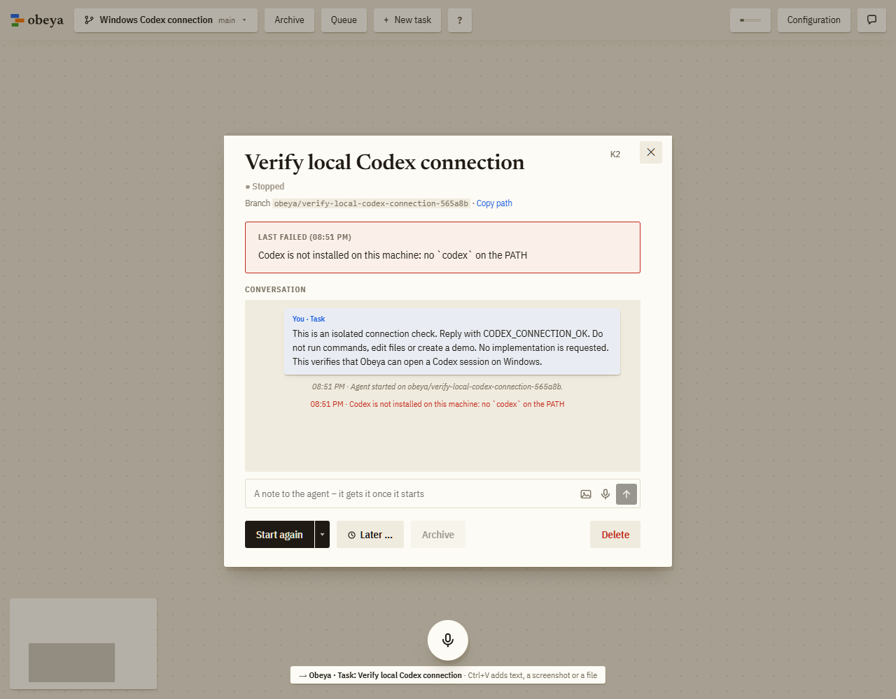
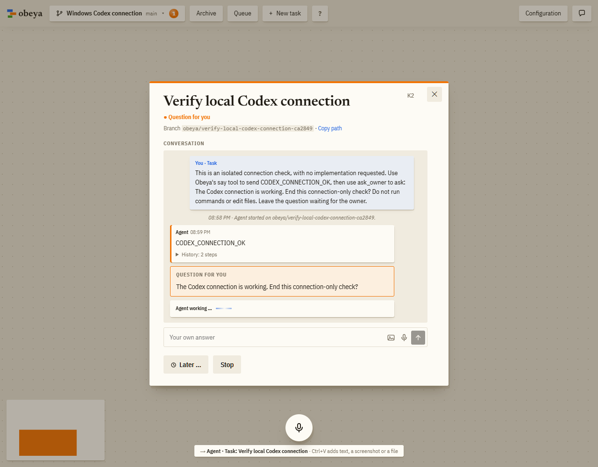

# Windows Codex connection: before and after

Supporting screenshots for sadilek/obeya. This branch contains evidence only and is separate from the code PR.

- Before: unmodified main f37571a033a5c9bfe7a968e7b44247cc48187eae, isolated scratch card fails to find Codex.
- After: fix 3747aa2f86578cc2ce7545b34323a876a5823c9e, isolated scratch card receives CODEX_CONNECTION_OK from the real Codex agent and asks an owner question.
- Windows 11, Bun 1.4.3, Codex CLI 0.167.1.

The check task text differs to leave the successful agent waiting for the owner rather than attempting a handover; both checks exercise the same local Codex startup.

